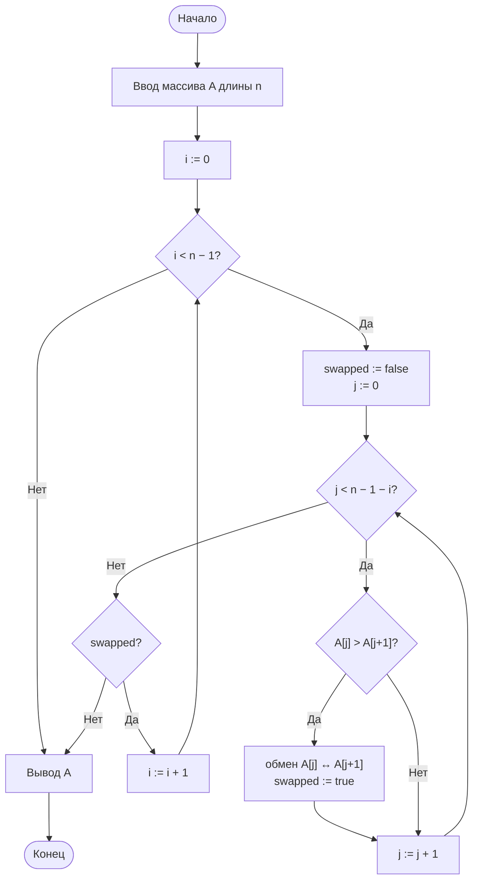
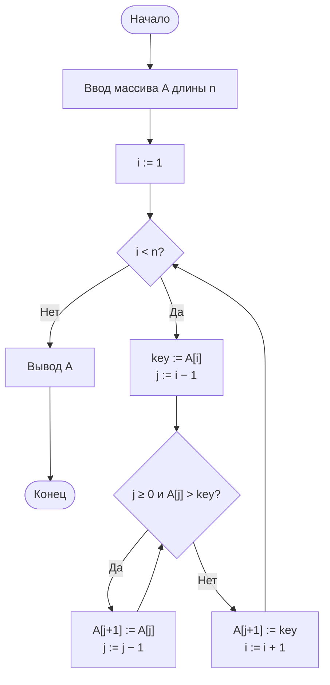

# Лабораторная работа № 2

**Дисциплина:** Основы алгоритмизации и программирование  
**Направление:** 38.03.05 «Бизнес-информатика»  
**Курс:** 2  
**Группа:** БИ 2-1  
**Выполнил:** студент группы БИ 2-1  
**ФИО:** Голдаева Валерия Валентиновна  
**Вариант:** 6  
**Год:** 2026

---

## 1. Цель работы и формулировка задания

**Цель работы:** освоить методику экспериментального исследования временной сложности алгоритмов и сопоставить эмпирические зависимости с теоретическими оценками на примере простых алгоритмов сортировки.

**Задание варианта 6:**

| Параметр | Значение |
|---|---|
| Алгоритмы | пузырёк (с флагом), вставки |
| Тип данных | **D** — много повторов, целые из $[0; 10]$ |
| Размеры $n$ | $500,\ 1000,\ 2000,\ 4000$ |
| Повторов измерения | $k = 5$, результат — **медиана** |
| Доп. задание | **М1** — число сравнений и обменов/сдвигов; проверка $\approx n^2/2$ и $\approx n^2/4$ |

Функции сортировки **не изменяют** исходный массив (возвращают новый список).

---

## 2. Краткое описание алгоритмов и оценки сложности

### 2.1. Сортировка пузырьком (с флагом)

На каждом проходе соседние элементы сравниваются и при необходимости меняются местами. Флаг `swapped` позволяет досрочно завершить работу, если за проход не было обменов.

| Случай | Сравнения | Обмены | Сложность |
|---|---|---|---|
| Лучший (уже упорядочен) | $n-1$ | $0$ | $\Theta(n)$ |
| Средний / худший | $\approx n^2/2$ | $O(n^2)$ | $\Theta(n^2)$ |

### 2.2. Сортировка вставками

Элементы по очереди вставляются в уже упорядоченную левую часть. Число сдвигов равно числу инверсий.

| Случай | Сравнения | Сдвиги | Сложность |
|---|---|---|---|
| Лучший | $n-1$ | $0$ | $\Theta(n)$ |
| Средний | $\approx n^2/4$ | $\approx n^2/4$ | $\Theta(n^2)$ |
| Худший | $\approx n^2/2$ | $\approx n^2/2$ | $\Theta(n^2)$ |

**Ожидание на данных D:** вставки примерно вдвое быстрее пузырька по числу сравнений ($n^2/4$ против $n^2/2$); при удвоении $n$ время растёт примерно в $4$ раза.

---

## 3. Блок-схемы алгоритмов

### 3.1. Сортировка пузырьком



### 3.2. Сортировка вставками



---

## 4. Листинг программы

```python
import random
import statistics
import time


def generate_data(n, kind="duplicates", lo=0, hi=10, seed=42):
    """Тип D: много повторов, целые из [lo; hi]."""
    rng = random.Random(seed + n)
    return [rng.randint(lo, hi) for _ in range(n)]


def bubble_sort(arr, count_ops=False):
    """Пузырёк с флагом. Не изменяет исходный массив."""
    a = arr.copy()
    n = len(a)
    comparisons = swaps = 0
    for i in range(n - 1):
        swapped = False
        for j in range(n - 1 - i):
            comparisons += 1
            if a[j] > a[j + 1]:
                a[j], a[j + 1] = a[j + 1], a[j]
                swaps += 1
                swapped = True
        if not swapped:
            break
    if count_ops:
        return a, comparisons, swaps
    return a


def insertion_sort(arr, count_ops=False):
    """Вставки. Не изменяет исходный массив."""
    a = arr.copy()
    comparisons = shifts = 0
    for i in range(1, len(a)):
        key = a[i]
        j = i - 1
        while j >= 0:
            comparisons += 1
            if a[j] > key:
                a[j + 1] = a[j]
                shifts += 1
                j -= 1
            else:
                break
        a[j + 1] = key
    if count_ops:
        return a, comparisons, shifts
    return a


def measure(sort_func, data, repeats=5):
    """Медианное время (с)."""
    times = []
    for _ in range(repeats):
        t0 = time.perf_counter()
        result = sort_func(data)
        times.append(time.perf_counter() - t0)
        assert result == sorted(data)
    return statistics.median(times)


def main():
    SIZES = [500, 1000, 2000, 4000]
    REPEATS = 5

    print(f"{'n':>6} {'bubble':>12} {'insertion':>12} {'ratio':>8}")
    times_b, times_i = [], []
    for n in SIZES:
        data = generate_data(n)
        tb = measure(bubble_sort, data, REPEATS)
        ti = measure(insertion_sort, data, REPEATS)
        times_b.append(tb)
        times_i.append(ti)
        print(f"{n:6d} {tb:12.6f} {ti:12.6f} {tb/ti:8.2f}")

    # М1
    print("\nМ1: сравнения")
    print(f"{'n':>6} {'cmp_b':>12} {'n^2/2':>12} {'cmp_i':>12} {'n^2/4':>12}")
    for n in SIZES:
        data = generate_data(n)
        _, cb, _ = bubble_sort(data, count_ops=True)
        _, ci, _ = insertion_sort(data, count_ops=True)
        print(f"{n:6d} {cb:12d} {n*n//2:12d} {ci:12d} {n*n//4:12d}")


if __name__ == "__main__":
    main()
```

---

## 5. Характеристики вычислительной системы

| Параметр | Значение |
|---|---|
| ОС | Linux |
| Язык / интерпретатор | Python 3.12 |
| Таймер | `time.perf_counter()` |
| Агрегация | медиана из 5 измерений |
| Генератор данных | фиксированный seed (воспроизводимость) |
| Тип данных | D — `randint(0, 10)` |

---

## 6. Результаты измерений

### 6.1. Медианное время работы, с

| $n$ | Пузырьком | Вставками | Отношение $T_b/T_i$ |
|---:|---:|---:|---:|
| 500 | 0.0098 | 0.0042 | 2.33 |
| 1000 | 0.0410 | 0.0190 | 2.16 |
| 2000 | 0.1714 | 0.0784 | 2.19 |
| 4000 | 0.6681 | 0.3071 | 2.18 |

### 6.2. Проверка квадратичности: $T(2n)/T(n)$

| Переход | Пузырьком | Вставками | Теория $\Theta(n^2)$ |
|---|---:|---:|---:|
| $500 \to 1000$ | 4.19 | 4.53 | 4 |
| $1000 \to 2000$ | 4.18 | 4.13 | 4 |
| $2000 \to 4000$ | 3.90 | 3.92 | 4 |

Отношения близки к $4$ — экспериментально подтверждена сложность $\Theta(n^2)$.

### 6.3. Нормировка $T(n)/n^2$

| $n$ | $T_b / n^2$ | $T_i / n^2$ |
|---:|---:|---:|
| 500 | $3{,}92\cdot10^{-8}$ | $1{,}68\cdot10^{-8}$ |
| 1000 | $4{,}10\cdot10^{-8}$ | $1{,}90\cdot10^{-8}$ |
| 2000 | $4{,}28\cdot10^{-8}$ | $1{,}96\cdot10^{-8}$ |
| 4000 | $4{,}18\cdot10^{-8}$ | $1{,}92\cdot10^{-8}$ |

Величины стабилизируются — дополнительное подтверждение квадратичного роста.

### 6.4. Доп. М1: сравнения и обмены/сдвиги

| $n$ | Cmp пузыр. | $\approx n^2/2$ | Cmp встав. | $\approx n^2/4$ |
|---:|---:|---:|---:|---:|
| 500 | 121 429 | 125 000 | 54 971 | 62 500 |
| 1000 | 495 035 | 500 000 | 233 824 | 250 000 |
| 2000 | 1 984 465 | 2 000 000 | 939 738 | 1 000 000 |
| 4000 | 7 916 190 | 8 000 000 | 3 599 876 | 4 000 000 |

Число сравнений согласуется с теоретическими оценками $\approx n^2/2$ (пузырёк) и $\approx n^2/4$ (вставки).

### 6.5. График $T(n)$

Зависимость времени от $n$ для обоих алгоритмов — параболический рост (квадратичный). Вставки стабильно быстрее пузырька примерно в $2{,}2$ раза на данных типа D.

*(При наличии файла `lr2_plot.png` он включается в отчёт как рисунок.)*

---

## 7. Выводы

1. **Квадратичная сложность $\Theta(n^2)$ подтверждена:** при удвоении $n$ время растёт в $3{,}9$–$4{,}5$ раза.
2. **Вставки** на данных D быстрее пузырька в $2{,}2$–$2{,}3$ раза (меньше сравнений; сдвиг дешевле обмена).
3. **М1:** число сравнений близко к $n^2/2$ и $n^2/4$.
4. Оба алгоритма пригодны лишь для небольших объёмов (тысячи элементов); для больших данных нужны алгоритмы $O(n\log n)$.

---

*Конец отчёта*
